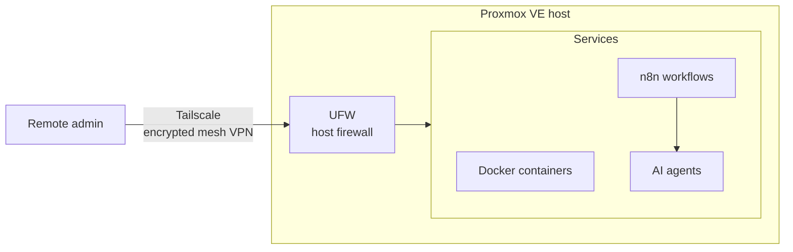

# Secure Home Lab & SecOps automation

My private infrastructure, used as a playground to practise **infrastructure security** and **security automation**: virtualization with **Proxmox VE** and **Docker**, controlled remote access with **Tailscale** and **UFW**, and **n8n workflows connected to AI agents**.

| | |
|---|---|
| **Period** | Since May 2026 (ongoing) |
| **Type** | Personal infrastructure project |
| **Focus** | Secure self-hosting · Remote access · SecOps automation |

---

## Architecture

---

## What I built

| Layer | Implementation | Security purpose |
|---|---|---|
| **Virtualization** | Proxmox VE + Docker containers (PostgreSQL, Portainer, FileBrowser) | Isolate services from each other and from the host |
| **Remote access** | Tailscale | Reach the lab through an authenticated, encrypted VPN |
| **Filtering** | UFW | Restrict which traffic the host accepts |
| **Automation** | n8n workflows + AI agents | Automate task management and API-driven publishing |
| **Monitoring** | Real-time metrics dashboard | Track system load, network bandwidth and the health of containers and services |

## Why it matters

A home lab is where security choices stop being theoretical: every service I expose, every port I open and every automation I add is a decision I have to secure and maintain myself. It is also where I prototype **SecOps automation** with n8n and AI agents before applying the ideas at work.

---

## Skills demonstrated

`Virtualization` · `Containers` · `Zero-trust style remote access` · `Host firewalling` · `Workflow automation` · `AI agents`

---

Personal lab. Part of my cybersecurity portfolio — see my [GitHub profile](https://github.com/Emmanueltankam) · Emmanuel Tankam Talla
